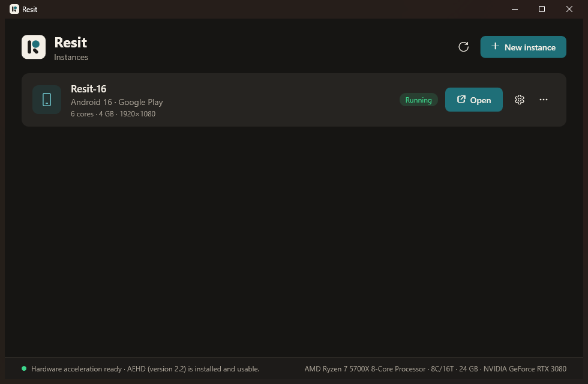

<p align="center"></p>

# Resit

A fast, ad-free Android emulator for Windows and Linux with the controls gamers expect: an
instance manager, performance settings, a sidebar of device buttons and keyboard-to-touch
game controls.

Resit runs Google's official Android Emulator and system images. It adds the setup,
the tuning and the gaming UI around it. The emulator draws straight to the screen with your
GPU (Resit embeds its window rather than streaming frames), so the UI costs no performance.

<p align="center"></p>

## Features

- **Instances**: create, start, stop, wipe and delete as many as you like, and run several at once.
  Choose any Android version Google publishes; Resit downloads it with a progress bar.
- **Two editions**:
  - **Google Play**: full Android with the Play Store.
  - **Minimal**: AOSP trimmed to Firefox and a file manager. No Google services, so it uses the least RAM and CPU.
- **Ad blocking**: Android's Private DNS points at AdGuard's free ad-blocking resolver, so ads and trackers fail to load in every app (one switch per instance).
- **Widescreen by default**: 1920×1080 like other gaming emulators, so fullscreen fills your monitor.
- **Auto-tuned performance**: CPU cores and RAM are sized from your PC, with presets or custom values.
- **Graphics**: host-GPU OpenGL rendering (plus DirectX via ANGLE on Windows), Vulkan, 60/90/120 Hz, and any resolution and DPI.
- **Game controls**: map keys to taps and a WASD joystick by dragging them onto the game.
  - Each control is a real finger, so multi-touch works.
  - Layouts are saved per game and load automatically when that game comes to the front.
  - Controls pause while Android's keyboard is up, so you can still type.
- **Sidebar**: Back, Home, Recents, volume, sound output device, rotate, screenshot, APK install, fullscreen (F11), and the emulator's extended controls (GPS, battery, camera…).
- **Keyboard**: type straight into Android with your PC keyboard. Ctrl+V pastes text copied on the PC. System shortcuts (Windows/Super key, Alt+Tab, Alt+F4) keep working.
- **Fullscreen**: the whole monitor, taskbar or panel included. Move the mouse to the top edge for a drop-down bar, or press F11 to leave.
- **Sound**: pick the output device per instance, even while playing.
- **Quick Boot**: closing saves a snapshot, so the next start resumes in seconds.
- **Lightweight**: no Android Studio, no Java. The setup script downloads only what the emulator needs.

## Requirements

| | Windows | Linux |
| --- | --- | --- |
| OS | Windows 10 or 11, 64-bit | x86-64 desktop with X11 or Wayland (Resit and the emulator use XWayland there) |
| Acceleration | AEHD or WHPX (set up from the app) | KVM: `/dev/kvm` usable by your user |
| Sound devices | built in | `pactl` (pulseaudio-utils; works with PipeWire) |
| Disk | about 15 GB free | about 15 GB free |

CPU virtualization must be enabled in the BIOS (Intel VT-x or AMD SVM). macOS is not supported yet.

## Install on Windows

```powershell
git clone https://github.com/MuzammilDesigner11/Resit.git
cd Resit
.\setup.ps1               # downloads the emulator + newest Android, creates the "Resit" instance
.\enable-hypervisor.ps1   # once: hardware acceleration (asks for admin)
.\build.ps1               # builds dist\windows\Resit.exe (and the Linux build)
.\dist\windows\Resit.exe
```

If PowerShell refuses to run the scripts, allow local scripts for your user first:

```powershell
Set-ExecutionPolicy -Scope CurrentUser RemoteSigned
```

Put the SDK on another drive if `C:` is tight: `.\setup.ps1 -SdkRoot E:\Android\Sdk -AvdHome E:\Android\avd`.

## Install on Linux

From a release archive (Releases page, or build one yourself below):

```bash
tar xzf resit-linux-x64.tar.gz
./resit/install.sh        # installs for your user: app menu entry and a `resit` command
~/.local/share/resit/setup.sh   # downloads the emulator + newest Android, creates the "Resit" instance
resit
```

From source (needs the [.NET 10 SDK](https://dotnet.microsoft.com/download)):

```bash
git clone https://github.com/MuzammilDesigner11/Resit.git
cd Resit
./setup.sh
./build.sh                # builds dist/linux/Resit and dist/resit-linux-x64.tar.gz
./dist/linux/Resit
```

`setup.sh` checks KVM and the libraries the emulator needs and tells you what to install.
If KVM is not usable, give your user access and log in again:

```bash
sudo usermod -aG kvm $USER
```

Press **Play** on the instance. The first boot of a new instance takes a few minutes; after that,
Quick Boot resumes it in seconds.

## Hardware acceleration on Windows

The emulator needs a hypervisor. `enable-hypervisor.ps1` (or the **Enable** button in the app)
picks one for you:

| | AEHD (Android Emulator Hypervisor Driver) | WHPX (Windows Hypervisor Platform) |
| --- | --- | --- |
| Reboot | No | Yes |
| Hyper-V for all of Windows | No | Yes |
| Other emulators (BlueStacks, MuMu, …) | Keep working as before | Need their Hyper-V builds |
| Chosen automatically when | Hyper-V is off | Hyper-V is already on (WSL2, Docker) |

Force one with `.\enable-hypervisor.ps1 -Driver Aehd` or `-Driver Whpx`.

## Game controls

1. Open the game and click the **gamepad** button in the sidebar.
2. Add a **Tap** button, drag it over the game's on-screen button, then press the key you want.
   Add a **Joystick** and drag it over the game's movement stick. It uses WASD; press ↑ while
   it is selected to switch to the arrow keys. Scroll over it to resize it.
3. Right-click or press Delete to remove a control. Click **Save**.

The layout is saved for that game (by Android package name) in `%APPDATA%\Resit\keymaps`
(`~/.config/Resit/keymaps` on Linux) and loads whenever the game is in front. The **keyboard**
button turns controls off. They also pause by themselves while Android's keyboard is showing.

## What it tunes

| Setting | Default | Why |
| --- | --- | --- |
| Acceleration | AEHD or WHPX on Windows, KVM on Linux | Runs guest code on the CPU directly instead of emulating it |
| CPU cores | One per physical core, up to what the emulator accepts | Hyperthreads add contention, not speed |
| RAM | 4 GB (presets up to 8 GB) | Plenty for games. Quick Boot snapshots hold all of the RAM, so more makes every start and close slower |
| Storage | Keep instances on an SSD | Android boot is random-read heavy; a hard drive makes it several times slower (Resit warns you) |
| Graphics | Host GPU | OpenGL ES and Vulkan run on your graphics card |
| GPU preference | High performance (`setup.ps1`) | Windows laptops with two GPUs use the fast one |
| Image | Newest stable x86_64 with 4 KB pages | Native architecture, no ARM translation for the OS |
| Boot | Quick Boot, no boot animation | Later starts resume in seconds |
| Process priority | High | The OS schedules the VM ahead of background work (on Linux this needs the CAP_SYS_NICE permission) |
| Screen | Always on, no lock screen | Games are never interrupted by sleep |

The emulator limits the number of vCPUs per hypervisor (6 with AEHD at the time of writing).
Resit reads that limit from the emulator's log the first time and caps its sliders to match.

## Command line

The GUI is optional. The scripts work on their own:

| Script | Does |
| --- | --- |
| `setup.ps1` / `setup.sh` | Installs the SDK pieces and creates an instance. Pick the image type (`google_apis` for root), pin an API level, override cores/RAM/storage, or recreate with force. `./setup.sh --help` lists the Linux options. |
| `start.ps1` | (Windows) Starts an instance with the same performance flags. `-ColdBoot`, `-Wipe`, `-NoAudio`, `-Headless`. |
| `enable-hypervisor.ps1` | (Windows) Turns on AEHD or WHPX. |
| `build.ps1` / `build.sh` | Builds the app: `dist\windows\Resit.exe` and/or `dist/linux/` with `dist/resit-linux-x64.tar.gz`. |

## How it works

```
Resit (Avalonia, one UI for Windows and Linux)
 ├─ Instance manager ── reads/writes the emulator's own AVD files (config.ini), so Android Studio
 │                      sees the same instances
 ├─ Player window ───── starts the emulator, then re-parents its native window into its own
 │                      (Win32 SetParent / X11 XReparentWindow); rendering stays on the GPU path
 ├─ Game controls ───── catches the keyboard while the player is in front (Windows keyboard hook /
 │                      X11 key grab) and turns keys into multi-touch events, sent over the
 │                      emulator's gRPC control API (streamInputEvent)
 └─ App watcher ─────── polls adb for the app in front, its orientation and the keyboard state,
                        to switch layouts, rotate the window and pause controls while typing
```

Source layout:

```
src/Resit/
  Core/       instances, SDK discovery, emulator process, gRPC client, keymaps
  Platform/   OS-specific parts: window embedding, keyboard capture, audio routing, hardware info
              (Win32 and X11 implementations side by side)
  Views/      main window, settings, player, game-controls overlay
  Protos/     the emulator's gRPC API definitions (Apache 2.0, from AOSP)
linux/        install script and desktop entry for Linux
tools/        build helpers
```

`src/Resit.Wpf/` holds the previous Windows-only (WPF) version while the cross-platform app
replaces it; it is not part of the build.

## Troubleshooting

- **"Hardware acceleration is off"**: on Windows run `.\enable-hypervisor.ps1`; on Linux make `/dev/kvm` usable (see above). Check virtualization is enabled in the BIOS.
- **Black screen or glitches in a game**: turn off Vulkan, or switch the renderer in Settings → Graphics.
- **"Playback failed" in a video app**: set Settings → Graphics → Video decoding to Software. Some protected (DRM) streams still won't play in any emulator; an older Android version can help.
- **An app stops loading or complains about an ad blocker**: turn off Settings → Device → Ads for that instance.
- **The Minimal edition's browser**: Mozilla's official Firefox for Android, downloaded on first start. Chrome is only distributed through the Play Store, so use the Google Play edition for Chrome.
- **Slow start ("checking the network")**: before booting, the emulator probes your network and DNS, which takes a minute on some networks.
- **Linux: the emulator does not start**: run `setup.sh` again; it lists missing libraries. The emulator log (⋯ → Open log) has the details.
- **Linux: key labels over the game**: shown while you edit the controls; showing them during play is Windows-only for now.
- **"Android SDK not found" on Windows although the SDK is there**: if you ran `setup.ps1` from a terminal inside a Microsoft Store (MSIX) app, such as an IDE or an AI assistant installed from the Store, Windows redirected everything it wrote under `AppData` into that app's private storage. Run setup from a normal terminal, or put the SDK outside AppData: `.\setup.ps1 -SdkRoot C:\Android\Sdk`.
- **Slow first start**: a new instance's first boot is a full Android boot (2–4 minutes). Later starts use Quick Boot.
- **Closing takes a while**: Quick Boot saves the instance's RAM to disk. Less RAM saves faster, or turn Quick Boot off in Settings → Advanced.
- **Logs**: `resit-emulator.log` in the instance folder (⋯ → Open log) and `resit.log` in `%APPDATA%\Resit` or `~/.config/Resit`.

## Roadmap

macOS, key labels during play on Linux, mouse-look aiming for shooters, repeat-tap and swipe
controls, gamepad support, macros, and installing the SDK from inside the app.

## License

MIT. See [LICENSE](LICENSE). The Android Emulator, system images and SDK tools are downloaded
from Google and covered by the [Android Software Development Kit License Agreement](https://developer.android.com/studio/terms),
which you accept by running setup. `src/Resit/Protos` holds API definitions from the Android Open
Source Project under the Apache License 2.0. The icons are from Microsoft's
[Fluent UI System Icons](https://github.com/microsoft/fluentui-system-icons) (MIT), and the UI
uses [Avalonia](https://avaloniaui.net/) (MIT) and the Inter typeface (OFL).
